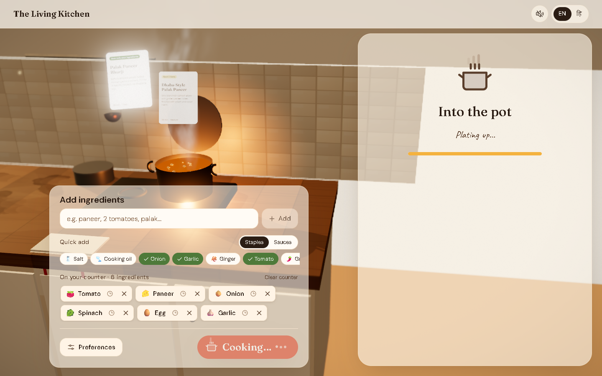
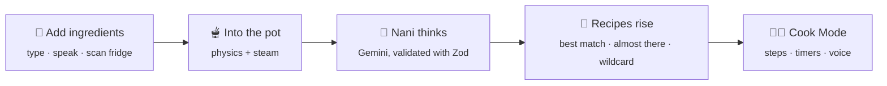
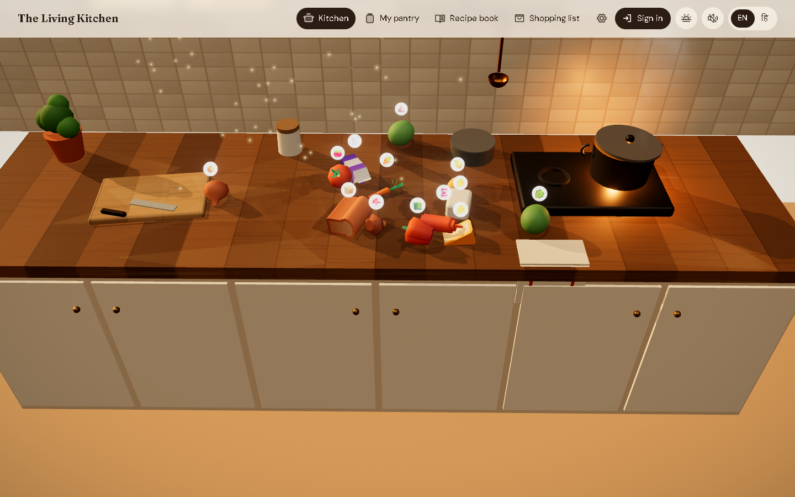
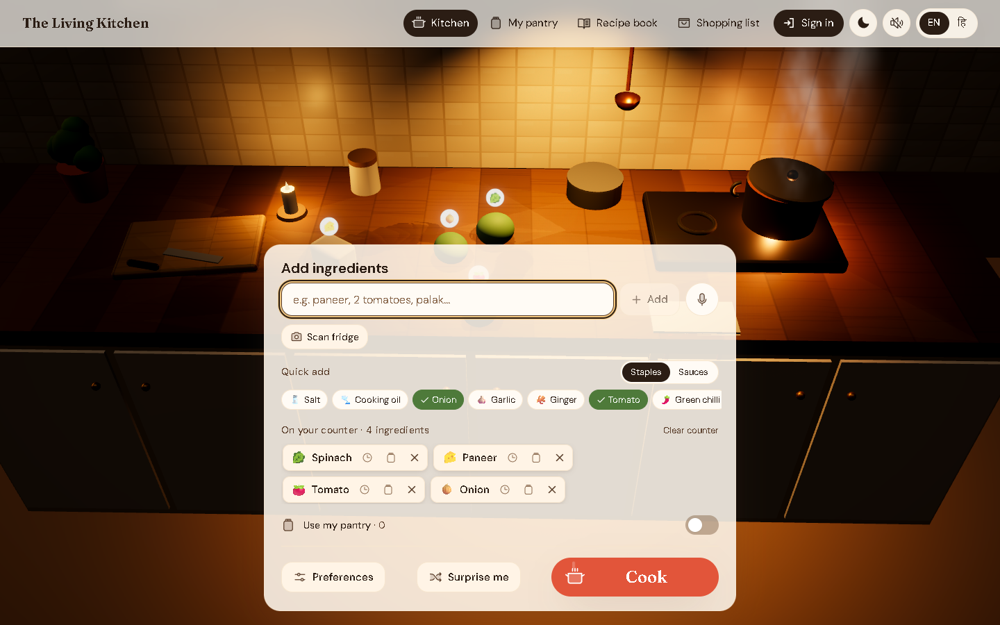
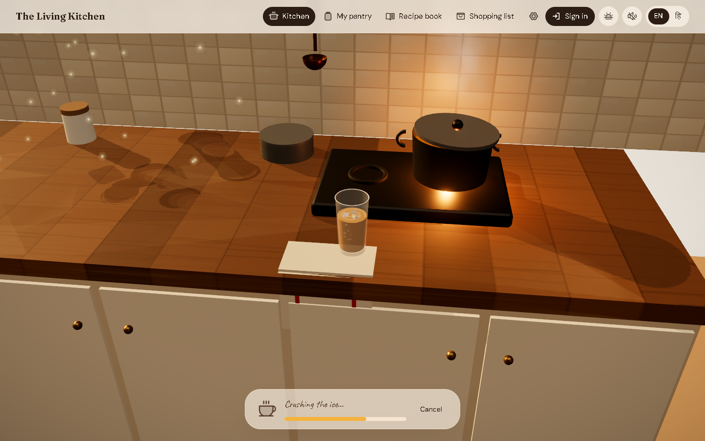
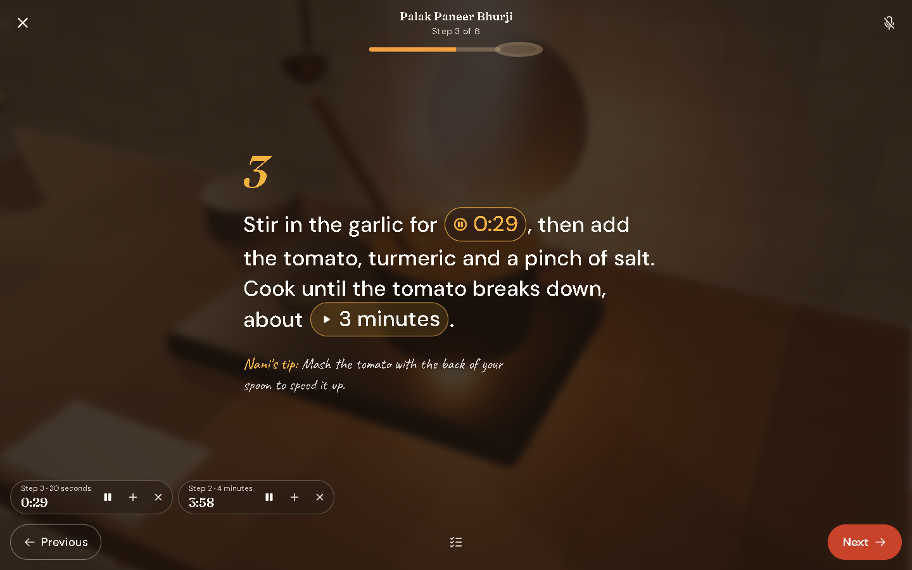
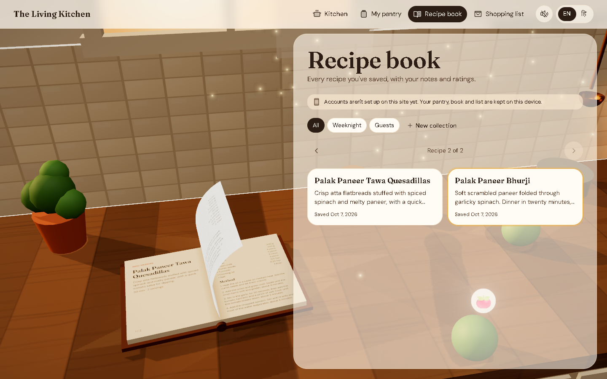
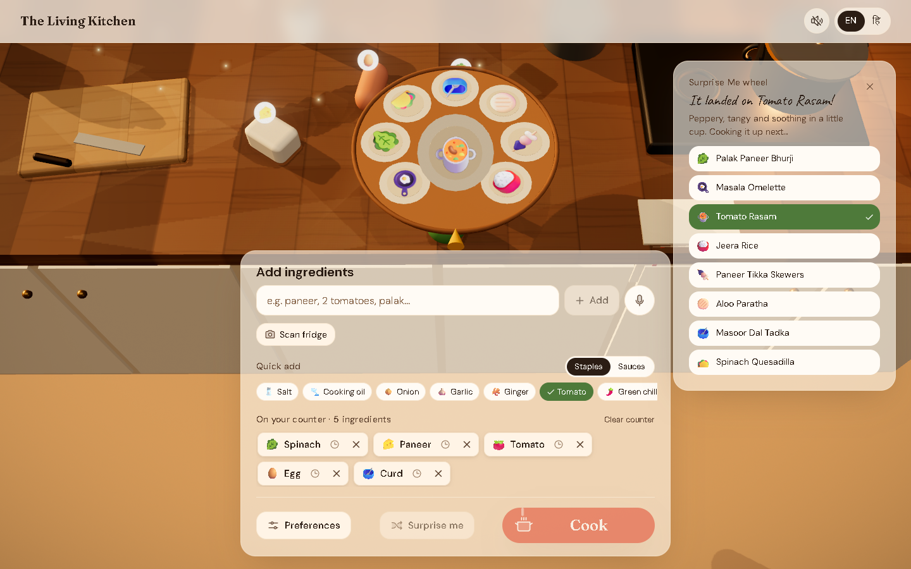

<div align="center">

# 🍲 The Living Kitchen

### _Tell the kitchen what you have, and watch dinner appear._

A cozy **3D kitchen counter** where your ingredients tumble into a pot, the pot bubbles while an AI chef thinks, and **recipes rise out of the steam**.

<br/>


**English** · **हिन्दी** · **বাংলা**

<br/>



<sub>Recipe cards rise out of the steam while the pot bubbles.</sub>

</div>

<br/>

## ✨ The idea

Most recipe apps are a search box and a list. **The Living Kitchen is a place.**

It's one warm kitchen counter at golden hour, with sunlight through the window, a wooden cutting board and a pot gently steaming on the stove.

- 🧅 Add an ingredient and it **drops onto the counter** with real physics, squashing and bouncing as it lands.
- 🔥 Press **Cook**: everything hops into the pot, the steam thickens, and **Nani**, your AI home chef, gets to work.
- 📜 A few seconds later, **three recipes rise out of the steam** as glass cards.

It feels like a premium cookbook that happens to be alive. And when you just want the recipe, everything works perfectly with 3D switched off.

<br/>

## 🍳 How it works



<br/>

## 🌟 Features

<table>
<tr>
<td width="50%" valign="top">

### 🥘 Three ways to start

- **What I have**: type, speak, or **snap your fridge**. Nani sends back 3 ideas:
  - one using only what you have;
  - one needing a couple of things;
  - one fun wildcard.
- **Name a dish**: _"Chilli Chicken"_ gets the full recipe.
- **What's for dinner?**: one tap, no typing. Nani picks from your pantry for this time of day.

</td>
<td width="50%" valign="top">

### 🍹 Food *and* drinks

- Switch to drinks and the pot becomes a **glass** that fills as Nani mixes.
- Chai, lassi, mocktails. Cocktails only if you ask.
- **Leftovers mode** turns yesterday's rice and rotis into something new, with food-safety tips.

</td>
</tr>
<tr>
<td valign="top">

### 👩‍🍳 Cook Mode

- Big, calm, one-step-at-a-time screens.
- Timers are **found in the text**: _"simmer for 10 minutes"_ becomes a tap-to-start timer.
- **Hands-free voice**, for example _"next"_, _"go to step 3"_, _"timer for 5 minutes"_, _"how much time is left?"_.

</td>
<td valign="top">

### 🧺 Your kitchen, remembered

- **Pantry** with expiry dates, and nudges to use things up.
- A **3D recipe book** with page turns, notes, ratings and photos.
- A **shopping list** grouped by aisle that you can send to **WhatsApp** in one tap.

</td>
</tr>
<tr>
<td valign="top">

### 🎡 Little moments of joy

- **Surprise Me** spins a lazy-susan wheel of dish ideas.
- The kitchen **follows your clock**: morning light, golden hour, or candle-lit night.
- **Share cards** turn any recipe into a beautiful image and link.

</td>
<td valign="top">

### 🌏 Made for Indian kitchens

- Fully translated: **English, हिन्दी, বাংলা**. Nani writes the recipes in your language too.
- It understands _"2 tamatar, pyaaz aur dhaniya"_ and _"২টো টমেটো, পালং আর ডিম"_.
- Quantities come in **katori, cups and grams**.

</td>
</tr>
</table>

<br/>

## 📸 A look around

<table>
<tr>
<td><p align="center"><sub>Real 3D ingredients land on the counter</sub></p></td>
<td><p align="center"><sub>The kitchen at night, lit by a candle</sub></p></td>
</tr>
<tr>
<td><p align="center"><sub>Drinks fill a glass instead of the pot</sub></p></td>
<td><p align="center"><sub>Cook Mode, with timers found in the text</sub></p></td>
</tr>
<tr>
<td><p align="center"><sub>A 3D recipe book that turns its pages</sub></p></td>
<td><p align="center"><sub>Spin the Surprise Me wheel</sub></p></td>
</tr>
</table>

<br/>

## 🚀 Quick start

> **You need:** Node.js 20+ and pnpm (`npm i -g pnpm`).

**1. Install**

```bash
pnpm install
```

**2. Add your settings**

```bash
cp .env.example .env.local
```

No API key yet? Set `NEXT_PUBLIC_MOCK_AI=1` to cook with built-in sample recipes. For real ones, get a **free** Gemini key at [aistudio.google.com](https://aistudio.google.com).

**3. Cook**

```bash
pnpm dev
```

Open **http://localhost:3000** and wait for **"✓ Pages ready"** in the terminal: every page is compiled in the background, so links respond instantly. Add a few ingredients and press **Cook**.

<details>
<summary><b>🔑 All environment variables</b></summary>

<br/>

`.env.local` is git-ignored: never commit it.

| Variable | Needed for |
|---|---|
| `NEXT_PUBLIC_MOCK_AI=1` | Sample recipes, no AI key needed |
| `AI_PROVIDER` | `gemini` (free tier) or `anthropic` |
| `GEMINI_API_KEY` · `GEMINI_MODEL` · `GEMINI_FALLBACK_MODEL` | Real recipes with Google Gemini |
| `ANTHROPIC_API_KEY` · `ANTHROPIC_MODEL` · `ANTHROPIC_VISION_MODEL` | Real recipes with Anthropic Claude (paid) |
| `NEXT_PUBLIC_SUPABASE_URL` · `NEXT_PUBLIC_SUPABASE_ANON_KEY` | Accounts, sync, sharing |
| `SUPABASE_SERVICE_ROLE_KEY` | Server-side rate limits, AI cache, account deletion |
| `SUPABASE_DB_URL` | `pnpm db:migrate` and the RLS tests |
| `NEXT_PUBLIC_SITE_URL` | Absolute links on share pages |

AI keys never reach the browser: every AI call goes through a Next.js route handler.

</details>

<details>
<summary><b>🗄️ Accounts and sync with Supabase (optional)</b></summary>

<br/>

Create a free [Supabase](https://supabase.com) project, add its keys to `.env.local`, then run:

```bash
pnpm db:migrate
```

Without Supabase the app still works fully, saving everything on your device.

</details>

<details>
<summary><b>🧰 All scripts</b></summary>

<br/>

| Command | What it does |
|---|---|
| `pnpm dev` | Dev server, plus a background warm-up of every page |
| `pnpm dev:fresh` | The same, after clearing the `.next` cache |
| `pnpm build` · `pnpm start` | Production build and server |
| `pnpm lint` · `pnpm typecheck` · `pnpm format` | ESLint, TypeScript and Prettier |
| `pnpm test` | Vitest unit tests (260+) |
| `pnpm e2e` | Playwright end-to-end and accessibility tests on desktop and mobile |
| `pnpm test:rls` | Row-level-security tests against your Supabase project |

</details>

<br/>

## 🧑‍🍳 Under the hood

| Layer | Built with |
|---|---|
| **App** | Next.js 15 (App Router), React 19, TypeScript (strict) |
| **3D** | React Three Fiber, drei, Rapier physics, postprocessing |
| **Motion** | GSAP camera timelines, Framer Motion for the UI |
| **Styling** | Tailwind CSS v4 with warm, editorial design tokens |
| **State** | Zustand; guests keep everything in localStorage |
| **AI** | Google Gemini (or Anthropic Claude), every answer validated with Zod and retried once |
| **Backend** | Supabase Auth, Postgres (row-level security), Storage |
| **i18n** | next-intl: English, Hindi, Bengali |
| **Quality** | Vitest, Playwright and axe-core, on desktop and mobile |

### 📏 Built to a budget

| | Target | Today |
|---|---|---|
| 🎨 Draw calls | under 100 | **89** at the busiest moment |
| 📦 Initial JS (kitchen page, without the 3D chunk) | under 250 kB | **247 kB** |
| 📱 Lighthouse mobile | 80+ | **81–82** |
| 🖥️ Lighthouse desktop | | **99** |
| ♿ Accessibility | WCAG AA | **0** axe violations across every screen |

<details>
<summary><b>📐 The project rules</b></summary>

<br/>

1. **Content first, 3D second.** The recipe UI must work fully with `?no3d=1`, with `prefers-reduced-motion`, and on low-end phones.
2. **Never block on 3D loading.** Show the static hero poster immediately and fade the canvas in when it's ready.
3. **Performance budget:**
   - under 100 draw calls;
   - each ingredient model under 200 KB;
   - initial JS under 250 KB gzipped (excluding the lazy 3D chunk);
   - 60 fps on desktop and 30+ fps on mid-range Android.
4. **AI output is untrusted.** Validate it with Zod against the recipe schema and retry once on failure. Never render raw HTML from the model.
5. **API keys stay server-side.** Every AI route is rate-limited.
6. **Accessibility:**
   - WCAG AA contrast;
   - a full keyboard flow;
   - the canvas is `aria-hidden`, with equivalent DOM content;
   - visible focus rings.
7. **Every ingredient works without a 3D model.** It falls back to a "clay blob" coloured by food group, with an emoji label.
8. **Small components.** 3D lives in `src/components/scene/**` and UI in `src/components/ui/**`. No 3D imports in server components.
9. **Tests:** pure logic is tested with Vitest, plus Playwright smoke tests for each feature.

</details>

<details>
<summary><b>📚 Design docs</b></summary>

<br/>

| File | Contents |
|---|---|
| [`01-product-spec.md`](docs/01-product-spec.md) | Features, flows and acceptance criteria |
| [`02-design-system.md`](docs/02-design-system.md) | Colours, type, components, motion |
| [`03-3d-scene.md`](docs/03-3d-scene.md) | Scene, lighting, camera shots, performance tiers |
| [`04-architecture.md`](docs/04-architecture.md) | Folder structure, data model, API, AI prompts, security |
| [`05-build-plan.md`](docs/05-build-plan.md) | The phased build plan |
| [`06-assets.md`](docs/06-assets.md) | 3D models, textures and sounds |
| [`DECISIONS.md`](docs/DECISIONS.md) | Every design and engineering decision, with measurements |
| [`recipe.schema.json`](reference/recipe.schema.json) | The JSON shape the AI must return |

</details>

<br/>

## 🙏 Credits

- 🥕 3D ingredient models from the [Kenney Food Kit](https://kenney.nl) (CC0). Thank you, Kenney!
- 🔤 Fraunces, DM Sans, Caveat and Noto fonts (SIL Open Font License).
- ✏️ Icons from [Phosphor](https://phosphoricons.com) (MIT).
- Full details are in [`public/CREDITS.md`](public/CREDITS.md).

<br/>

<div align="center">

**Made with ❤️, physics, and a generous pinch of garam masala.**

_If this made you hungry, leave a ⭐_

</div>
