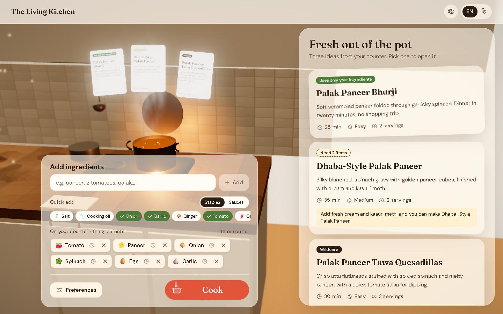

# The Living Kitchen

Tell the kitchen what you have and watch dinner appear.

The Living Kitchen is a 3D recipe generator set on one cozy kitchen counter.
- Ingredients you add drop onto the counter with physics.
- When you press **Cook**, they tumble into the pot, the pot bubbles while the AI thinks, and the recipes rise out of the steam.
- Everything also works without 3D (`?no3d=1`), with reduced motion, and on low-end phones.



## Features

**Getting recipes**
- **What I have.** Type, speak or scan your fridge. Nani suggests 3 recipes:
  - one using only what you have;
  - one needing a couple of items;
  - one wildcard.
- **Name a dish.** Ask for "Chilli Chicken" and get the full recipe.
- **What's for dinner?** One tap. Nani picks one dish from your pantry for this time of day.
- **Food or drinks.** Drinks are made in a glass instead of the pot; alcohol is included only if you ask for it.
- **Leftovers mode** turns yesterday's rice or rotis into something new.
- **Surprise Me** spins a wheel of dish ideas.

**Cooking**
- Cook Mode shows big step-by-step screens with timers found in the step text.
- It can be driven hands-free by voice, in English, Hindi and Bengali.

**Organising**
- Pantry with expiry dates, and nudges to use things up.
- A 3D recipe book with notes, ratings and photos.
- A shopping list grouped by aisle that you can send on WhatsApp.

**The kitchen itself**
- Languages: English, हिन्दी and বাংলা, including the AI's recipes.
- Day/night kitchen lighting that follows your clock.
- Accounts with sync across devices (magic link), and shareable recipe pages with share cards.

## Tech stack

- **App:** Next.js 15 (App Router) and TypeScript (strict).
- **3D:** React Three Fiber, drei, rapier (physics) and postprocessing.
- **Motion:** GSAP for camera timelines, Framer Motion for the 2D UI.
- **Styling and state:** Tailwind CSS v4 with design tokens; Zustand for client state.
- **Validation:** Zod for all AI output and API input.
- **AI:** Google Gemini (free tier) by default, or Anthropic Claude, chosen with `AI_PROVIDER`.
- **Backend:** Supabase for Auth, Postgres and Storage. Guests use localStorage.
- **i18n:** next-intl (en, hi, bn).
- **Tests:** Vitest for logic, Playwright with axe for end-to-end and accessibility.

## Getting started

Requirements: **Node.js 20+** and **pnpm** (`npm i -g pnpm`).

```bash
pnpm install
cp .env.example .env.local
pnpm dev
```

Open http://localhost:3000. `pnpm dev` also warms up every page in the background; wait for "✓ Pages ready" in the terminal before you click around.

### Environment variables

Fill in `.env.local` (see `.env.example`). It is git-ignored: never commit it.

| Variable | Needed for |
|---|---|
| `NEXT_PUBLIC_MOCK_AI=1` | Running with built-in sample recipes. No AI key needed. |
| `AI_PROVIDER` | `gemini` or `anthropic` |
| `GEMINI_API_KEY`, `GEMINI_MODEL`, `GEMINI_FALLBACK_MODEL` | Real recipes with Gemini. Free key at https://aistudio.google.com |
| `ANTHROPIC_API_KEY`, `ANTHROPIC_MODEL`, `ANTHROPIC_VISION_MODEL` | Real recipes with Claude instead (paid) |
| `NEXT_PUBLIC_SUPABASE_URL`, `NEXT_PUBLIC_SUPABASE_ANON_KEY` | Accounts, sync, sharing |
| `SUPABASE_SERVICE_ROLE_KEY` | Server-side rate limits, AI cache, account deletion |
| `SUPABASE_DB_URL` | `pnpm db:migrate` and the RLS tests |
| `NEXT_PUBLIC_SITE_URL` | Absolute links in share pages |

All AI keys stay server-side; AI calls go through Next.js route handlers.

### Database (optional)

Create a free Supabase project, put its keys in `.env.local`, then run:

```bash
pnpm db:migrate
```

The migrations are in `supabase/migrations/`. Without Supabase the app still works, with everything saved on the device.

## Scripts

| Command | What it does |
|---|---|
| `pnpm dev` | Dev server, plus a background warm-up of every page |
| `pnpm dev:fresh` | The same, after clearing the `.next` cache |
| `pnpm build` / `pnpm start` | Production build and server |
| `pnpm lint` | ESLint |
| `pnpm typecheck` | `tsc --noEmit` |
| `pnpm test` | Vitest unit tests |
| `pnpm e2e` | Playwright end-to-end and accessibility tests (builds with mock AI) |
| `pnpm test:rls` | Row-level-security tests against your Supabase project |
| `pnpm format` | Prettier |

## Project rules

1. **Content first, 3D second.** The recipe UI must work fully with `?no3d=1`, with `prefers-reduced-motion`, and on low-end phones.
2. **Never block on 3D loading.** Show the static hero poster immediately and fade the canvas in when it's ready.
3. **Performance budget:**
   - under 100 draw calls;
   - each ingredient model under 200 KB;
   - initial JS under 250 KB gzipped (excluding the lazy 3D chunk);
   - 60 fps on desktop and 30+ fps on mid-range Android.
4. **AI output is untrusted.** Validate it with Zod against the recipe schema and retry once on failure. Never render raw HTML from the model.
5. **API keys stay server-side.** Every AI route is rate-limited.
6. **Accessibility:**
   - WCAG AA contrast;
   - a full keyboard flow;
   - the canvas is `aria-hidden`, with equivalent DOM content;
   - visible focus rings.
7. **Every ingredient works without a 3D model.** It falls back to a "clay blob" coloured by food group, with an emoji label.
8. **Small components.** 3D lives in `src/components/scene/**` and UI in `src/components/ui/**`. No 3D imports in server components.
9. **Tests:** pure logic is tested with Vitest, plus Playwright smoke tests for each feature.

## Docs

| File | Contents |
|---|---|
| `docs/01-product-spec.md` | Features, flows and acceptance criteria |
| `docs/02-design-system.md` | Colours, type, components, motion |
| `docs/03-3d-scene.md` | Scene, lighting, camera shots, performance tiers |
| `docs/04-architecture.md` | Folder structure, data model, API, AI prompts, security |
| `docs/05-build-plan.md` | The phased build plan |
| `docs/06-assets.md` | 3D models, textures and sounds |
| `docs/DECISIONS.md` | Every design and engineering decision, with measurements |
| `reference/recipe.schema.json` | The JSON shape the AI must return |

## Credits

- 3D ingredient models are from the [Kenney Food Kit](https://kenney.nl) (CC0).
- Fonts are under the SIL Open Font License; icons are Phosphor (MIT).
- Full details are in [`public/CREDITS.md`](public/CREDITS.md).
